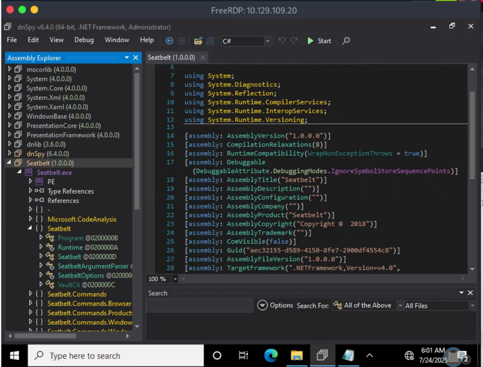
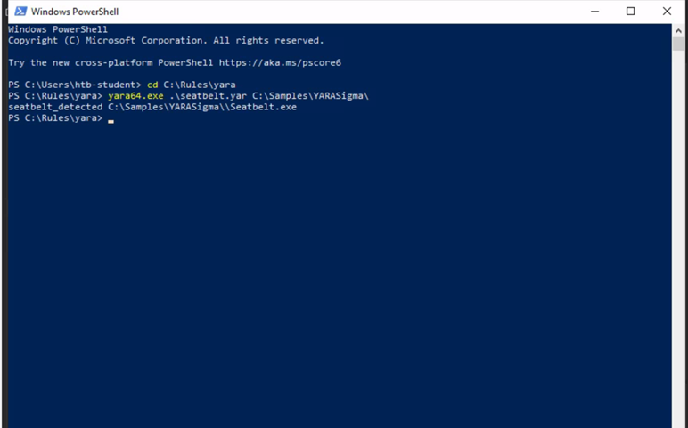
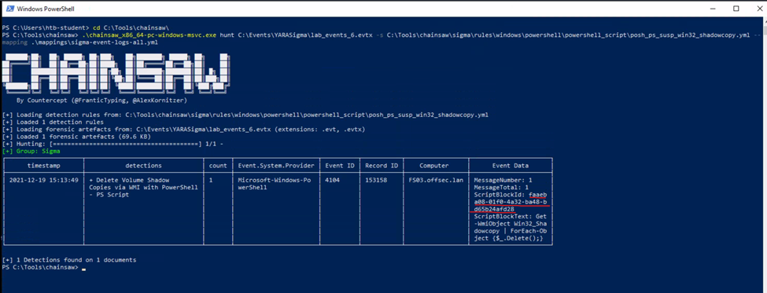

# 07 - Detection Engineering Capstone 

## Executive Summary

This capstone assessment combines two core Detection Engineering disciplines: YARA rule development and Sigma-based threat hunting. The first assessment focuses on improving a YARA rule through static malware analysis, while the second applies Sigma detection logic using Chainsaw against offline Windows event logs. 

Together, the exercises demonstrate how detection engineering techniques can be applied to identify.NET assembly artifacts and suspicious PowerShell activity potentially associated with ransomware anti-recovery techniques using standardized detection logic.

The YARA investigation identified the class name **LsaWrapper** in the Seatbelt sample and documented a successful rule match after updating the missing string. The Sigma investigation identified a PowerShell Script Block event associated with **Win32_ShadowCopy** deletion logic and extracted its ScriptBlock ID from an offline EVTX log.

## Assessment Objectives

- Develop and improve YARA detection rules through malware analysis.
- Identify malware-specific artifacts within .NET assemblies.
- Validate YARA rules against malware samples.
- Execute Sigma rules using Chainsaw against offline Windows Event Logs.
- Detect PowerShell activity associated with Shadow Volume Copy deletion.
- Identify indicators commonly associated with ransomware behavior.
- Correlate detection engineering concepts with MITRE ATT&CK techniques where supported by the observed evidence..

## Investigation Context

The assessment was designed to evaluate practical detection engineering skills across two complementary scenarios. 

The first required analysts to inspect a .NET sample and improve an existing YARA rule by replacing a missing detection artifact. The second required analysts to execute a Sigma rule using Chainsaw to identify PowerShell activity associated with the deletion of Windows Volume Shadow Copies. 

Together, both exercises provide controlled Hack The Box Academy practice in detection engineering involving malware analysis, rule development, and offline log hunting.

## Background

### Capstone Overview

This assessment combines static malware analysis with offline event log hunting to evaluate practical Detection Engineering skills.

Analysts are required to inspect a provided .NET executable, improve detection rules, execute Sigma-based detections, and resulting findings using Windows event telemetry examine matching results from the relevant file scans and Windows event telemetry.

### Assessment Part I – YARA Rule Development

The first assessment focuses on improving an existing YARA rule used to detect the Seatbelt post-exploitation framework. 

By inspecting the .NET assembly with dnSpy and identifying characteristic class names, the missing detection string is added to the rule to complete the detection logic and test it against the supplied sample.

### Assessment Part II – Sigma Hunting with Chainsaw

The second assessment focuses on detecting PowerShell activity associated with Windows Volume Shadow Copy deletion. 

Using Chainsaw and Sigma rules, analysts perform offline threat hunting against Windows Event Logs to identify potential anti-recovery activity and extract the associated ScriptBlock ID.

## MITRE ATT&CK Mapping (Background)

| Technique | ATT&CK ID |
|-----------|-----------|
| PowerShell | T1059.001 |
| Inhibit System Recovery | T1490 |

## Tools Used

| Tool | Purpose |
|------|---------|
| YARA | Malware detection |
| dnSpy | .NET assembly analysis |
| Chainsaw | Offline EVTX hunting |
| Sigma | Detection rules |
| Windows PowerShell | Event analysis |

## Data Sources

| Source | Purpose |
|---------|----------|
| Seatbelt.exe | .NET executable analysis |
| seatbelt.yar | YARA rule validation |
| Windows EVTX Logs | Event investigation |
| Sigma Rule | PowerShell detection |
| Chainsaw | Offline event analysis |

## Assessment Scope

The assessment focuses on validating practical detection engineering skills through malware analysis and offline Windows event log hunting.

Activities include YARA rule development, .NET assembly inspection, Sigma rule execution, and identification of PowerShell artifacts potentially associated with ransomware anti-recovery behavior.

## Assessment Methodology

The assessment followed a structured methodology:

1. Review the supplied detection rule.
2. Analyze the associated malware sample or event logs.
3. Identify missing detection artifacts.
4. Improve or execute the detection rule.
5. Validate the generated detection.
6. Document the observed results and assess the limitations of the available evidence.

## Assessment Overview

The assessment consists of two independent investigations designed to evaluate complementary Detection Engineering skills. 

The first investigation validates static malware detection through YARA rule development, while the second examines suspicious PowerShell script block content using Sigma rules executed with Chainsaw against offline Windows Event Logs.

### Assessment Part I – YARA Rule Development

Seatbelt is a .NET-based post-exploitation framework developed as part of the GhostPack toolkit. 

It is commonly used for host enumeration, privilege assessment, credential discovery, and situational awareness during post-exploitation activities. 

Detection frequently relies on identifying distinctive .NET class names and other tool-related artifacts.

## 1. Static .NET Analysis and YARA Rule Improvement 

**Analysis Objective**: Inspect the supplied **Seatbelt.exe** .NET assembly using dnSpy, identify the missing class-name artifact required by the existing YARA rule, and test the updated rule against the provided sample.

**Identified Class**: 'LsaWrapper'

**Rule Variable**: '$class2'

### Figure 12 - Seatbelt.NET Assembly Analysis 



## YARA Rule Validation

### Purpose

Validate the updated YARA rule against the provided Seatbelt sample after identifying the missing class through static .NET assembly inspection.

### Command

``` cmd
yara64.exe .\seatbelt.yar C:\Samples\YARASigma\
```
### Results

| Field | Value |
|-------|-------|
| Malware Sample | `Seatbelt.exe` |
| Missing Class | `LsaWrapper` |
| Detection Status | Successful — reported match against the supplied sample |

### Figure 13 - Successful YARA Rule Valdiation 



### Analysis

The updated YARA rule successfully detected the Seatbelt sample after replacing the placeholder with the class name LsaWrapper.

Because the rule required four matching strings, adding the missing class contributed to satisfying the rule's documented matching condition.

The result demonstrates a successful match against the provided sample. It does not establish the rule's effectiveness against other Seatbelt versions, modified assemblies, or unrelated benign .NET applications.

## Investigation Findings

Static analysis of the .NET assembly identified `LsaWrapper` as the missing tool-related class required by the YARA rule. 

After updating the rule, successful validation confirmed that the detection logic matched the supplied Seatbelt executable.

This provides evidence of rule functionality for the tested sample, while broader detection accuracy and false-positive performance remain untested.

## Detection Engineering Concepts

### .NET Assembly Analysis 

Many modern malware families are developed using the Microsoft .NET framework. 

Tools such as dnSpy allow analysts to inspect compiled assemblies, enumerate namespaces, classes, methods, and embedded strings, making it possible to identify stable artifacts suitable for YARA detection.

### YARA Rule Development 

YARA rules are developed by selecting distinctive file characteristics such as strings, imported libraries, .NET metadata, PE headers, file structure, or other distinguishing artifacts. 

Well-designed rules balance detection accuracy with a low false-positive rate by relying on relevant combinations of indicators rather than generic strings.

### Malware-specific String Selection

Selecting malware-specific strings is one of the most important aspects of YARA rule development. 

Characteristic class names such as `LsaWrapper`, together with other distinctive artifacts, provide potentially useful detection features, although their uniqueness and reliability should be evaluated against benign software and other versions of the targeted tool.

## Detection Logic

### PE Validation 

The YARA rule is described as verifying that the analyzed file is a valid Portable Executable (PE) by checking the `MZ` header and the `PE` signature. 

These checks help restrict matching to files with expected PE header characteristics, depending on how the conditions are implemented.

### .NET Detection (BSJB) 

The `BSJB` string is a characteristic marker found within .NET assemblies. 

Detecting this value allows the rule to identify an expected CLR metadata signature and strengthen its focus on .NET assemblies.

### Multi-string Rule Matching (“4 of them”)

The condition `4 of them` requires that at least four predefined strings be present before the rule generates a match. 

This threshold requires multiple string matches, which can improve specificity when the selected strings are sufficiently distinctive. However, the threshold alone does not establish a low false-positive rate.

Technical clarification: The meaning of '4 of them' depends on the rule's actual 'strings' section and full Boolean condition. The complete 'seatbelt.yar' rule was not included in this section, so the stated PE and CLR checks should be verified against the original rule before publication.

## Assessment Part II – Sigma Hunting with Chainsaw

Windows Volume Shadow Copies provide recovery snapshots that can be used to restore files following accidental deletion or ransomware encryption. Attackers frequently remove these snapshots before encrypting data to prevent recovery, making Shadow Copy deletion a valuable behavioral detection opportunity.

## 2. Offline Sigma Hunting for Shadow Copy Deletion 

**Analysis Objective**: Execute the provided Sigma rule using Chainsaw against an offline Windows event log and identify PowerShell Script Block content associated with **Win32_ShadowCopy** deletion operations.

**EVTX File**: 'lab_events_6.evtx'

**Sigma Rule**: 'posh_ps_susp_win32_shadowcopy.yml'

## Chainsaw Sigma Detection

### Purpose 

Detect PowerShell activity associated with Shadow Volume Copy deletion.

### Command 

```cmd
.\chainsaw_x86_64-pc-windows-msvc.exe hunt C:\Events\YARASigma\lab_events_6.evtx -s C:\Tools\chainsaw\sigma\rules\windows\powershell\powershell_script\posh_ps_susp_win32_shadowcopy.yml --mapping .\mappings\sigma-event-logs-all.yml
```

The relative mapping path '.\mappings\sigma-event-logs-all.yml' assumes that the command is executed from the appropriate Chainsaw working directory.

### Results 

| Field | Value |
|-------|-------|
| Tool | `Chainsaw` |
| Event ID | `4104` |
| Detection | Shadow Copy Deletion — suspicious script block content |
| ScriptBlock ID | `faaeba08-01f0-ba48-bd65-b24afd28` |

### Figure 14 - Chainsaw Shadow Copy Deletion Detection



### Analysis

The Sigma rule identified PowerShell Script Block Logging events containing commands that invoked the Delete() method against Win32_ShadowCopy.

Review of the event data revealed the associated ScriptBlock ID.

The recovered identifier links the finding to the relevant PowerShell script block. The event supports detection of code associated with Shadow Copy deletion, but does not independently confirm that the deletion completed successfully.

## Investigation Findings

Chainsaw successfully executed the Sigma rule against the offline Windows Event Logs and identified PowerShell activity consistent with Shadow Volume Copy deletion. 

The recovered ScriptBlock ID identified the script block associated with a potential attempt to inhibit system recovery.

The observed script content is consistent with a known ransomware anti-recovery technique. However, the available evidence does not establish ransomware attribution or confirm that Windows Volume Shadow Copies were successfully removed.

## Detection Logic

### PowerShell Script Block Detection 

The Sigma rule monitors PowerShell Script Block Logging (Event ID 4104) for commands associated with Shadow Volume Copy manipulation. 

Inspection of ScriptBlock content provides direct visibility into potentially malicious PowerShell activity.

### Shadow Copy Deletion Detection 

Commands invoking `Win32_ShadowCopy` together with the `Delete()` method represent strong indicators of attempts to remove Windows Volume Shadow Copies. 

Because ransomware frequently performs this action before encrypting files, such behavior should be treated as high-priority during investigations.

A matching script block should be correlated with the executing user, host, process context, and other system events to distinguish unauthorized anti-recovery activity from legitimate administrative operations.

### ScriptBlock ID Correlation

The ScriptBlock ID identifies a PowerShell script block and can be used to correlate related logging records, including fragments of the same script block where applicable.

Correlating this identifier with ScriptBlock content enables analysts to group related script block records and simplifies incident reconstruction.

A ScriptBlock ID is not a process ID or a unique identifier for an entire PowerShell execution session.

## Investigation Artifacts and Detection Indicators

| IOC Type | Value |
|-----------|-------|
| Malware Sample | `Seatbelt.exe` |
| Missing Class | `LsaWrapper` |
| Detection Tool | `YARA` |
| Sigma Rule | `posh_ps_susp_win32_shadowcopy.yml` |
| Event ID | `4104` |
| Detection | Shadow Volume Copy Deletion — suspected activity |
| ScriptBlock ID | `faaeba08-01f0-ba48-bd65-b24afd28` |

**Note**: These values represent a mixture of sample names, rule metadata, telemetry identifiers, and detection artifacts. They should not all be classified as IOCs. The **LsaWrapper** class is a candidate YARA detection string, while the ScriptBlock ID is an event-correlation identifier specific to the analyzed log.

## MITRE ATT&CK Mapping

| Tactic | Technique | ATT&CK ID | Investigation Relevance |
|--------|-----------|-----------|-------------------------|
| Execution | PowerShell | `T1059.001` | PowerShell Script Block activity |
| Impact | Inhibit System Recovery | `T1490` | Potential Shadow Volume Copy deletion through 'Win32_ShadowCopy' and 'Delete()' |


## Lessons Learned

| Lesson | Description |
|---------|-------------|
| Static Malware Analysis | .NET class names provide potentially useful artifacts for YARA rule development. |
| Rule Validation | Updating a single malware-specific artifact can restore a rule's ability to match a particular sample, depending on the complete matching condition. |
| YARA Detection | Combining multiple indicators can improve rule specificity when the indicators are sufficiently distinctive and appropriately tested. |
| Offline Threat Hunting | Chainsaw enables efficient execution of Sigma rules against offline Windows Event Logs. |
| PowerShell Visibility | Event ID 4104 provides detailed visibility into PowerShell script block content that may reveal suspicious or malicious behavior. |
| Ransomware Detection | Shadow Volume Copy deletion is a valuable anti-recovery detection opportunity, although legitimate administrative activity and other causes must be considered. |

## Conclusion 

This capstone assessment demonstrated the complementary roles of YARA rule development and Sigma-based threat hunting within Detection Engineering. 

Through static malware analysis and offline Windows event log investigation, analysts successfully improved a YARA rule for detecting the Seatbelt framework and identified PowerShell activity associated with Shadow Volume Copy deletion.

Together, these exercises illustrate how multiple detection engineering techniques can be combined to improve malware detection, behavioral analysis, and incident response capabilities.

The documented results demonstrate a successful YARA match against the provided Seatbelt sample and a Sigma detection of suspicious PowerShell script block content in an offline EVTX log. Broader YARA detection performance and successful Shadow Copy deletion were not independently established by the available evidence.
